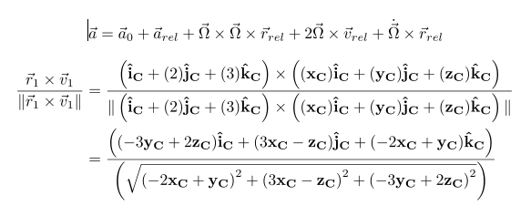
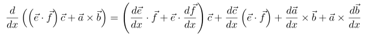
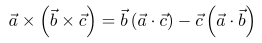
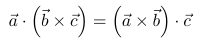
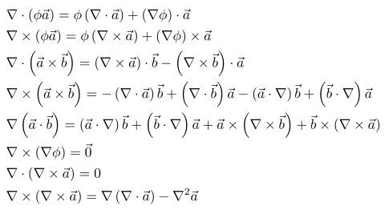
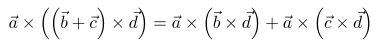
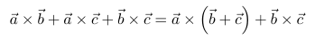
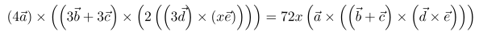
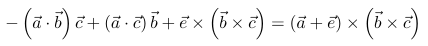
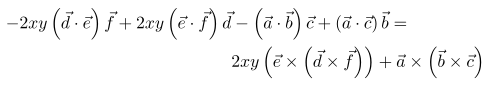

# Vector Expressions for Sympy

## Motivation

With Sympy we can write general symbolic expression by using symbols, functions, numbers,...., which are instances of the class `Expr`.

Similarly, we can write symbolic matrix expression using instances of the class `MatrixExpr`. We can also substitute dense or sparse matrices into those symbolic expressions.

Unfortunately, vector expressions (involving dot and cross products, magnitude, divergence, curl, ...) are not implemented yet. This is a highly experimental module to implement **vector expressions**. At the moment, only basic functionalities and printing are implemented. Take a look at the Jupyter notebooks **Tutorial** to learn how to use it. Also, feel free to help with the development.

## Project status - updated 11/6/26

This repository is archived and is no longer under active development. It remains publicly available for reference and for anyone interested in continuing the work.

My contributions include a mathematical requirements and functionality specification for symbolic vector algebra and calculus in SymPy, particularly the nabla operator.

- [Nabla functionality specification (PDF)](https://github.com/tomdunbar/sympy_vector_expressions/blob/ReBaseline_dvd_1/Docs/NablaFunctionality.pdf) — available on the `ReBaseline_dvd_1` branch.
- [Original SymPy discussion](https://github.com/sympy/sympy/issues/18987)

Anyone interested in continuing development is welcome to fork this repository.

## Features

### Derivatives

### Identities

### Expansion

### Collection

### Simplification

## TODO

* Operation precedence.
* Printing need some works.
* Integrals of vector expressions.
* Solve for vector expressions.
* Gradient: the gradient of a vector field is a tensor (matrix). Is it possible to implement them in this module? Specifically, is it possible to substitute a tensor/matrix into a vector expression and perform the evaluation? Is it possible to integrate them with tensor and linear algebra modules?
